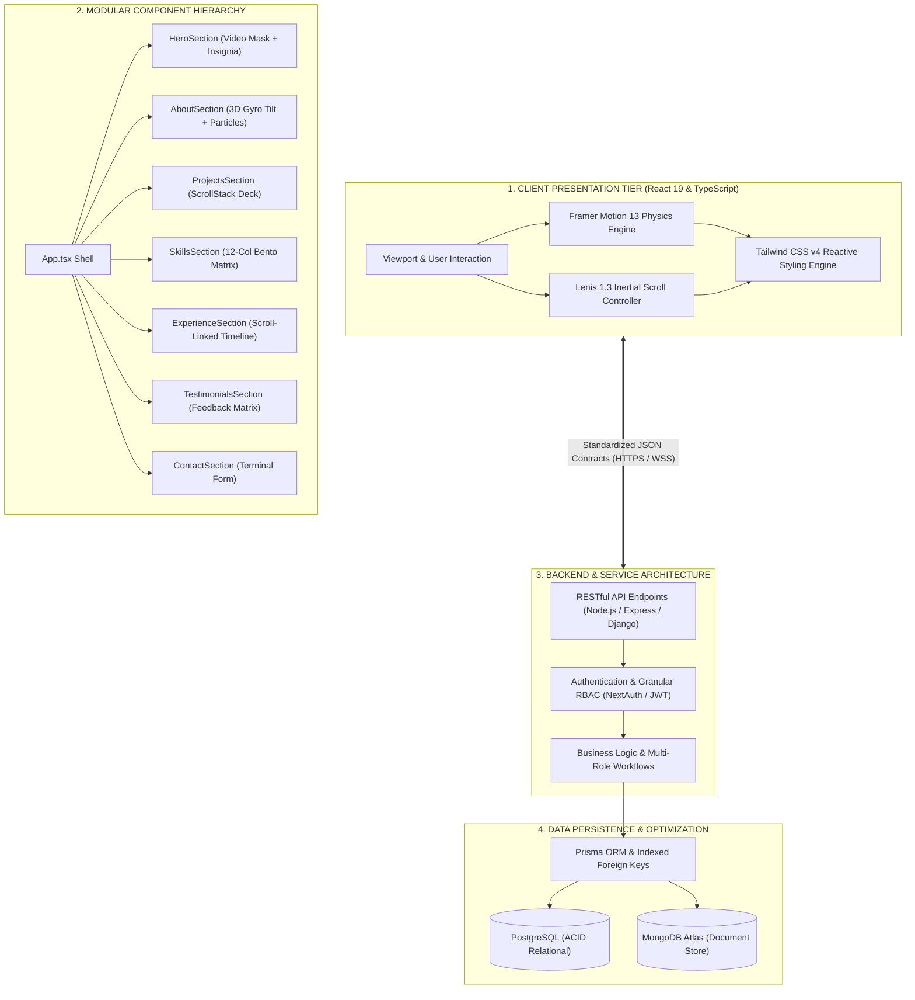
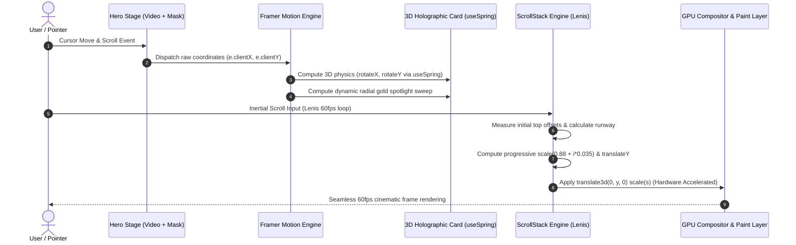
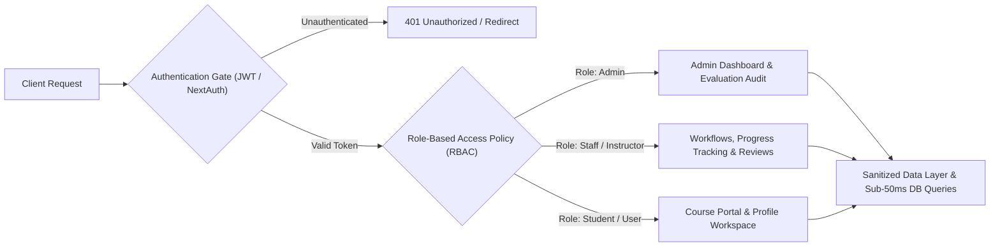

# 🎬 Kenenisa Beyan — Cinematic Portfolio

<div align="center">

[](https://react.dev/)
[](https://www.typescriptlang.org/)
[](https://vitejs.dev/)
[](https://tailwindcss.com/)
[](https://www.framer.com/motion/)
[](https://lenis.darkroom.engineering/)

<br />

**A luxury, film-noir cinematic web portfolio engineered for performance, modularity, and immersive motion design.**

[Explore Live Demo](https://kenenisa-one.vercel.app/) • [Download Resume](https://kenenisa-one.vercel.app/Kenenisa_Beyan_CV.pdf) • [Connect on LinkedIn](https://www.linkedin.com/in/kenenisa/) • [Report Bug](https://github.com/kenenisabeyan/Cinematic-pro/issues)

</div>

---

## 🌟 Overview & Identity

Designed for **Kenenisa Beyan** — Full-Stack Software Engineer, Computer Science & Engineering student at Adama Science & Technology University (ASTU), Founder of the EDOT education platform, and MinT/KOICA Startup Innovation Fellow.

This portfolio merges **luxury editorial aesthetics** with **rigorous system architecture**, featuring real-time 3D physics, hardware-accelerated video layering, and an interactive stacking deck scroll engine.

```
       ✦  C I N E M A T I C   P R E C I S I O N  ✦
   ┌───────────────────────────────────────────────────┐
   │  Obsidian Black (#000000)  Brushed Gold (#D4AF37) │
   │  Warm Bronze    (#8C6D4F)  Cream Text   (#E8DFD8) │
   └───────────────────────────────────────────────────┘
```

---

## 🏛️ System Architecture & Data Flow

### 1. High-Level Full-Stack System Diagram



---

### 2. Client-Side Rendering & 3D Motion Pipeline



---

### 3. Multi-Role RBAC & Security Workflow



---

## ⚡ Architectural Rigor & Quality Standards

| Engineering Pillar | Architectural Standard | Implementation Details |
| :--- | :--- | :--- |
| **Clean Architecture & SOLID** | Strict Separation of Concerns | Distinct separation between UI layout, reactive state, business logic, and data schema representations. |
| **Security & Granular RBAC** | Zero-Trust Role Isolation | Multi-role dashboards, hashed credential storage, JWT tokens, and sanitized inputs mitigating injection attacks. |
| **Database Optimization** | Sub-50ms Query Performance | Schema normalization in PostgreSQL and MongoDB, indexed foreign keys, optimized joins, and persistent connection pooling. |
| **Predictable APIs** | RESTful HTTP Contracts | Standardized HTTP status codes, structured JSON responses, input boundary validation, and centralized error handling. |
| **Component Modularity** | Reusable Component Systems | Type-safe React components powered by TypeScript interfaces, reusable contexts, and decoupled animation controllers. |
| **Production Readiness** | Enterprise Delivery Standards | Strict environment variable isolation, automated Vite bundler optimization, CORS safety, and minimal bundle footprint. |

---

## ⚡ Key Feature Implementations

### 1. 🎥 Cinematic Video Stage (`HeroSection.tsx`)
- **Atmospheric Background Canvas**: Fixed-position, muted looping hero video (`/videos/hero.mp4`) blended using directional gradient masks (`from-black via-black/85 to-transparent`).
- **Harmonic Oscillating Insignia**: Ambient breathing emblem animation (`y: [-3, 3, -3]`, `scale: [1, 1.03, 1]`) with dynamic gold drop shadow.
- **Sculpted Typography**: Headline using `Bebas Neue` condensed type with multi-stop metallic gold text clips (`from-[#F7E7C4] via-[#C99E5D] to-[#543B1A]`).

### 2. 🎴 3D Holographic Card & Physics (`AboutSection.tsx`)
- **Real-Time Gyro Tilt**: Utilizes Framer Motion's `useMotionValue` and `useSpring` (`stiffness: 220, damping: 18`) to calculate realistic 3D perspective tilts based on mouse cursor coordinates.
- **Dynamic Laser Border & Spotlight**: Mouse-following radial spotlight sweep and glowing corner accent brackets.
- **Verified Metrics**: Live numerical badges highlighting project deployments, fellowships, and academic excellence.

### 3. 🃏 Interactive ScrollStack Engine (`ProjectsSection.tsx` & `ScrollStack.tsx`)
- **Editorial Card Stacking**: Cards dynamically lock and stack atop one another using computed vertical translations (`translateY`) and progressive geometric scaling (`scale(0.88 + i * 0.035)`).
- **Lenis Smooth Scroll Pipeline**: Butter-smooth 60fps scroll hijacking with cubic-bezier easing (`duration: 1.2`), creating a tactile editorial deck.

### 4. 🍱 Architectural Bento Grid (`SkillsSection.tsx`)
- **Asymmetric 12-Column Matrix**: Structured layout categorized into Frontend Architecture, Distributed Backend, Data Platforms, and System Design.
- **Interactive Badges**: Real-time hover triggers with brushed-gold glow flares and monospace latency metrics.

### 5. 📍 Scroll-Linked Route Timeline (`ExperienceSection.tsx`)
- **Animated SVG Track Line**: Scroll progress dynamically drives the height of an illuminated gold track (`useTransform(scrollYProgress, [0, 1], ['0%', '100%'])`).
- **Interactive Nodes**: Chronological milestones spanning software engineering roles, startup fellowships, and university education.

### 6. 💬 Client Endorsements Matrix (`TestimonialsSection.tsx`)
- **Real-World Impact**: Dynamic showcase featuring client testimonials and project outcomes.
- **Aesthetic Cards**: Featuring custom initial monogram badges, gold quotation marks, and responsive grid alignment.

### 7. 🛰️ Mission-Control Terminal (`ContactSection.tsx`)
- **Monolith Command Palette**: Terminal-styled direct contact form with monospaced metadata prefixes (`// SENDER`, `// CHANNEL`, `// PAYLOAD`).
- **Direct Dispatch Feedback**: Interactive state machine transitioning from input capture to packet confirmation.

---

## 🛠️ Technology Matrix

| Layer | Technologies |
| :--- | :--- |
| **Runtime & Core** | [React 19](https://react.dev/), [TypeScript 6](https://www.typescriptlang.org/), [Vite 8](https://vitejs.dev/) |
| **Styling & Theme** | [Tailwind CSS v4](https://tailwindcss.com/) (Oxidized CSS Engine), `@tailwindcss/vite` |
| **Motion & Physics** | [Framer Motion 13](https://www.framer.com/motion/) (Spring physics, transforms) |
| **Smooth Scrolling** | [Lenis 1.3](https://lenis.darkroom.engineering/) (Inertial scroll physics) |
| **Typography** | `Bebas Neue`, `Montserrat`, `Herr Von Muellerhoff`, `Cinzel` |
| **Quality & Linting** | [Oxlint](https://oxc.rs/docs/guide/usage/linter) (High-performance Rust-based linter) |

---

## 📁 Project Architecture

```bash
cinematic-pro/
├── public/
│   ├── favicon.svg             # Minimalist luxury tab icon
│   ├── icons.svg               # SVG sprite definitions
│   └── videos/
│       └── hero.mp4            # Cinematic background loop
├── src/
│   ├── assets/                 # Optimized branding & portrait assets
│   │   ├── about.png           # Monolith card portrait
│   │   ├── hero.png            # Video poster fallback
│   │   └── watermark.png       # Oscillating brand insignia
│   ├── components/             # Modular section components
│   │   ├── HeroSection.tsx     # Stage, video canvas & typography
│   │   ├── AboutSection.tsx    # 3D tilt card & bio matrix
│   │   ├── ProjectsSection.tsx # Featured project data
│   │   ├── ScrollStack.tsx     # Custom stacking deck engine
│   │   ├── ScrollStack.css     # Runway & 3D transform layers
│   │   ├── SkillsSection.tsx   # 12-col bento grid
│   │   ├── ExperienceSection.tsx # Scroll-driven timeline
│   │   ├── TestimonialsSection.tsx # Client feedback grid
│   │   └── ContactSection.tsx  # Terminal dispatch form
│   ├── App.tsx                 # Master view shell
│   ├── main.tsx                # React 19 entry point
│   └── index.css               # Tailwind v4 import & font definitions
├── index.html                  # HTML5 shell & Google Fonts preconnect
├── package.json                # Dependencies & scripts
├── tsconfig.json               # TypeScript compiler config
└── vite.config.ts              # Vite 8 + Tailwind v4 plugin pipeline
```

---

## 🚀 Getting Started

### Prerequisites

Ensure you have the following installed:
- [Node.js](https://nodejs.org/) (`v20.0.0` or higher recommended; tested on `v22.18.0`)
- [npm](https://www.npmjs.com/) or [pnpm](https://pnpm.io/)

### 1. Clone the Repository

```bash
git clone https://github.com/kenenisabeyan/Cinematic-pro.git
cd Cinematic-pro
```

### 2. Install Dependencies

```bash
npm install
```

### 3. Launch Development Server

```bash
npm run dev
```

Open your browser and navigate to **`http://localhost:5173`** (or the port indicated in your console).

### 4. Build for Production

```bash
npm run build
```

This compiles optimized chunks into the `/dist` directory in under **600ms**.

### 5. Preview Production Build

```bash
npm run preview
```

---

## 🎨 Flexibility & Customization Guide

This project is built from the ground up to be **modular and easily customizable**:

### Modifying Content
- **Bio & Highlight Stats**: Update text and metrics directly in [`src/components/AboutSection.tsx`](src/components/AboutSection.tsx).
- **Featured Projects**: Edit the `projects` array in [`src/components/ProjectsSection.tsx`](src/components/ProjectsSection.tsx) to add or change project titles, tech tags, and GitHub URLs.
- **Skills Matrix**: Modify `bentoCategories` in [`src/components/SkillsSection.tsx`](src/components/SkillsSection.tsx).
- **Career Timeline**: Update the `journey` array in [`src/components/ExperienceSection.tsx`](src/components/ExperienceSection.tsx).
- **Client Reviews**: Edit `testimonials` in [`src/components/TestimonialsSection.tsx`](src/components/TestimonialsSection.tsx).

### Tuning the Card Deck Animation
In [`src/components/ProjectsSection.tsx`](src/components/ProjectsSection.tsx), adjust the `<ScrollStack>` props:
```tsx
<ScrollStack
  itemDistance={20}         // Distance between cards before stacking
  itemScale={0.035}         // Scale reduction factor per stacked card
  itemStackDistance={28}    // Visual offset of stacked cards at the top
  stackPosition="15%"       // Viewport percentage where stacking locks
  baseScale={0.88}          // Scale of the base card
>
```

---

## 📬 Contact & Connect

**Kenenisa Beyan**  
Full-Stack Software Engineer • Adama, Ethiopia  

- 🌐 **Portfolio**: [kenenisa-one.vercel.app](https://kenenisa-one.vercel.app/)
- 💻 **GitHub**: [@kenenisabeyan](https://github.com/kenenisabeyan)
- 💼 **LinkedIn**: [linkedin.com/in/kenenisa](https://www.linkedin.com/in/kenenisa/)
- 🐦 **Twitter/X**: [@kenenisa94931](https://twitter.com/kenenisa94931)
- 📧 **Email**: [kenenisab05@gmail.com](mailto:kenenisab05@gmail.com)

---

<div align="center">
  <sub>© 2026 Kenenisa Beyan. Engineered with precision, clean architecture, and passion.</sub>
</div>
